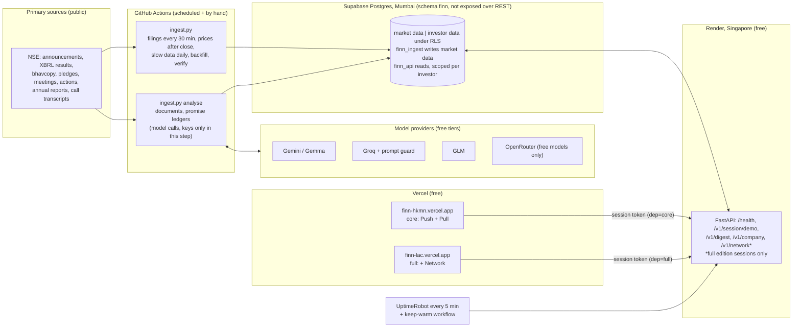

# FINN architecture

One codebase, two deployments: `finn-core` (Push and Pull) and `finn` (Push, Pull and Network),
built from the same `web/` with one build switch, served by one API that decides per session which
edition the caller is. Everything runs on free tiers; nothing costs money.

## Data pipeline

- **Fetch** (`pipeline/finn/sources/`): one NSE client with a session-cookie warm-up, 0.7 s pacing,
  retries with backoff and jitter; parsers for each feed, tested against recorded real responses.
- **Store** (`pipeline/finn/ingest.py`): idempotent upserts; every run logged in `finn.ingest_runs`
  with its counts and errors; a failed day is recorded and skipped, never fatal; an empty source is
  an error, never "nothing happened" (the pledge feed keeps its last published copy, dated).
- **Classify and rank** (`classify.py`, `rank.py`): rules first (the glossary's categories plus
  governance), with the reason each item was chosen; models only for what rules cannot name.
- **Results** (`xbrl.py`, `results.py`, `stored.py`): figures come from the company's own XBRL
  filing, the latest revision per quarter and basis, with general, bank and lender templates.
- **Schedule** (`.github/workflows/ingest.yml`): filings every 30 minutes, prices after the close,
  slow data daily; manual jobs for backfill, verification and analysis.

## Security and privacy

- **Database**: schema `finn` is not served by Supabase's REST API; Supabase's own API roles hold no
  privilege on it (`finn.lockdown()` runs last in every migration). Row-level security on every
  table. Two roles: `finn_ingest` (writes market data, cannot see investors) and `finn_api` (reads
  market data, sees only the investor named in the transaction, `finn.investor_id`).
- **API**: signed, read-only demo sessions (HMAC-SHA256, 12 hours) that record which site started
  them; an exact origin allow-list per edition; network routes refuse core sessions; rate limits
  per client (Cloudflare's `True-Client-IP`); 16 KB bodies; 5 s statement timeout; one error shape;
  security headers on every response; Sentry collects nothing personal.
- **Web**: strict Content-Security-Policy (no inline script or style, `connect-src` names only the
  API and Sentry), HSTS, frame denial; the build refuses an API address the policy does not allow;
  the session token lives in memory only; the service worker never caches the API.
- **Models**: filing and transcript text is data: screened by a prompt-injection guard, delimited,
  never given tools, outputs schema-checked, and every quoted claim string-matched against its
  source or dropped. Network data never reaches a model.
- **Network data** (full edition): synthetic and labelled so; owned by the investor under RLS;
  computed in SQL and code.
- **Supply chain**: exact pins, `pip-audit` and `npm audit` in CI, gitleaks over the full history,
  read-only workflow tokens, inputs passed through the environment; Render deploys only after CI
  passes. Model keys reach only the model step of the analysis job.

## Models and agents

Code asks for a role, never a model (`pipeline/finn/llm.py`): "reader" for long documents (Gemini
Flash-Lite models, then the quality tier), "reasoner" for promise-versus-delivery judgements (GLM,
then Gemini's quality tier), "fast" for short jobs (Groq). Each role has a fallback chain ending in a
free OpenRouter model; answers are cached by a hash of their inputs and every call is logged with
tokens, latency and fallback. Coding agents built the project in reviewed streams; the build history
is in the repository's commits and `docs/DECISIONS.md`.

## Cloud

| Part | Where | Why |
| --- | --- | --- |
| Ingest and analysis | GitHub Actions | free, scheduled, secrets kept there |
| Database | Supabase, Mumbai | Postgres with pgvector and row-level security, free |
| API | Render, Singapore | closest free region to India; kept warm by UptimeRobot |
| Web | Vercel | static, global, free; security headers in `web/vercel.json` |
